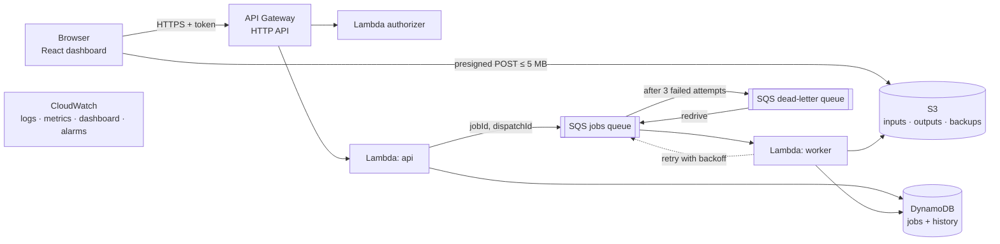

# QueuePilot

[](https://github.com/roshanjhawar23/QueuePilot/actions/workflows/ci.yml)
[](LICENSE)


**A cloud-native asynchronous file-processing and failure-recovery platform built on AWS serverless.**

Upload a CSV, text or JSON file and QueuePilot queues a job, processes it in the background on AWS Lambda, and shows you every attempt. When something fails you can see exactly why, watch automatic retries with backoff, find jobs that ran out of attempts in a real **SQS dead-letter queue**, and recover them with a corrected retry or a one-click redrive.

> **Everything the dashboard shows is read from AWS at request time** (S3, SQS, DynamoDB, Lambda). There is no mock or sample data in the application. The only deliberate failures come from a clearly labelled **fault-injection demo control**. It makes the real worker fail on purpose, and everything after that (exceptions, timeouts, SQS redelivery, the DLQ, CloudWatch alarms) is genuine.

---

## Contents

1. [Features](#features)
2. [Architecture](#architecture)
3. [Tech stack](#tech-stack)
4. [Prerequisites](#prerequisites)
5. [Quick start (local, no AWS needed)](#quick-start-local-no-aws-needed)
6. [Deploy to AWS](#deploy-to-aws)
7. [Using QueuePilot](#using-queuepilot)
8. [Project structure](#project-structure)
9. [Command reference](#command-reference)
10. [Configuration](#configuration)
11. [Testing](#testing)
12. [Cost](#cost)
13. [Security](#security)
14. [Troubleshooting](#troubleshooting)
15. [Tear down](#tear-down)
16. [Documentation](#documentation)
17. [Project status](#project-status)
18. [Contributing and license](#contributing-and-license)

---

## Features

**Three real job types**

| Job type | Accepts | What it computes | Results (in S3) |
|---|---|---|---|
| `csv.summary` | `.csv` | Row validation, per-column counts and missing values, min/max/mean/median/std-dev, top categories, date ranges, malformed-row report with line numbers | `result.json`, `cleaned.csv` |
| `text.analytics` | `.txt`, `.md` | Word, sentence and paragraph counts, reading time, top meaningful terms, long sentences (Markdown syntax stripped first) | `result.json` |
| `data.validate` | `.csv`, `.json` + your rules | Required fields, data types (string, number, integer, boolean, date, email), numeric ranges, allowed values | `report.json` |

**Reliability and recovery**

- **Uploads:** the strict **5 MB limit** is enforced by S3 itself via a presigned POST policy.
- **Submission:** `Idempotency-Key` makes it **idempotent**, so a double-click never creates two jobs.
- **Automatic retries:** exponential backoff, 5 s then 20 s.
- **Errors are classified.** Bad data fails fast as `FAILED` with no wasted retries. Persistent errors go to the **dead-letter queue** after 3 attempts.
- **Recovery:**
  - **per-job retry**, optionally with **corrected parameters**;
  - **bulk DLQ redrive** using SQS's native `StartMessageMoveTask`;
  - **stale and duplicate message protection** (dispatch IDs, leases, conditional writes);
  - **Lambda timeout recovery**;
  - **backup and restore** of selected job records, with SHA-256 integrity checks.
- **Observability:** structured CloudWatch logs per job, custom metrics, a ready-made CloudWatch dashboard and 4 alarms.

**Clearly labelled fault injection (for demos)**

| Mode | Behaviour |
|---|---|
| Transient | Fails attempts 1–2, succeeds on attempt 3 |
| Permanent | Fails every attempt, then lands in the DLQ |
| Slow task | Attempt 1 exceeds the Lambda timeout (a real timeout); attempt 2 succeeds |

---

## Architecture



How one job flows:
1. The browser uploads the file straight to S3.
2. The API records the job in DynamoDB and puts a small message on SQS.
3. A worker Lambda picks it up, processes the file, writes the results to S3 and updates the job's status and history.
4. Failures are retried, classified, and parked in the DLQ when they don't recover.

Full details (job states, data model, API, design trade-offs and known limitations) are in **[docs/ARCHITECTURE.md](docs/ARCHITECTURE.md)**.

---

## Tech stack

| Layer | Technology |
|---|---|
| Frontend | React 19, TypeScript, Vite, React Router |
| API | Amazon API Gateway (HTTP API) + Lambda authorizer |
| Compute | AWS Lambda (Node.js 22, arm64), bundled with esbuild |
| Messaging | Amazon SQS standard queue + dead-letter queue |
| Database | Amazon DynamoDB (on-demand, single table, 2 GSIs, TTL) |
| Storage | Amazon S3 (private data bucket, static website bucket) |
| Monitoring | Amazon CloudWatch (logs, Embedded Metric Format metrics, dashboard, alarms) |
| Security | AWS IAM least-privilege roles per function |
| Infrastructure as code | AWS SAM / AWS CloudFormation |
| Validation | zod schemas shared by backend and frontend |
| Tests | Vitest, Testing Library, aws-sdk-client-mock, live end-to-end suite |

---

## Prerequisites

| Tool | Version | Needed for | Install |
|---|---|---|---|
| **Node.js** | 22.12 or newer | Everything | <https://nodejs.org> (LTS) |
| **Git** | any | Cloning | <https://git-scm.com> |
| **AWS account** | — | Deployment only | <https://aws.amazon.com/free> |
| **AWS CLI** | v2 | Deployment only | [Install guide](https://docs.aws.amazon.com/cli/latest/userguide/getting-started-install.html) |
| **AWS SAM CLI** | latest | Deployment only | [Install guide](https://docs.aws.amazon.com/serverless-application-model/latest/developerguide/install-sam-cli.html) |
| **PowerShell** | 5.1+ (built into Windows) or 7+ | Helper scripts | macOS/Linux: [install PowerShell 7](https://learn.microsoft.com/powershell/scripting/install/installing-powershell), or use the [manual commands](#option-b-manual-commands-any-os) |

**Docker is not required.**

Check what you have:
```bash
node --version    # v22.12.0 or newer
git --version
aws --version     # aws-cli/2.x  (deployment only)
sam --version     # SAM CLI, version 1.x  (deployment only)
```

---

## Quick start (local, no AWS needed)

```bash
git clone https://github.com/roshanjhawar23/QueuePilot.git
cd QueuePilot
npm ci            # installs the exact dependency versions from package-lock.json
npm run check     # type-check + lint + 120 unit tests + production builds
```

`npm run check` should finish with every test passing. That confirms your machine is set up correctly.

> **Windows tip:** if Windows Security "Controlled folder access" protects the folder you cloned into (for example Documents, Desktop, or a folder you added), Git and npm will fail with *Permission denied*. Clone into an unprotected folder such as `C:\dev`, or allow `git.exe` and `node.exe` under *Windows Security → Ransomware protection → Allow an app through Controlled folder access*.

The dashboard needs a deployed backend to show data, so continue with the deployment below.

---

## Deploy to AWS

Expected time: **30–45 minutes** the first time (mostly one-time account setup). Expected cost: **a few dollars or less** (see [Cost](#cost)). Every command that touches AWS is run by you, from your own terminal.

### Step 1: Create a safe AWS identity (one time)

Never deploy with the AWS **root** user. Use IAM Identity Center (single sign-on), which gives short-lived credentials with no access keys to leak:

1. AWS Console → **IAM Identity Center** → *Enable*.
2. *Users* → *Add user*.
3. *Permission sets* → *Create* → predefined `AdministratorAccess`. This is the simplest choice for a personal learning account, because SAM creates IAM roles.
4. *AWS accounts* → select your account → *Assign users* → your user + that permission set.
5. Copy the **AWS access portal URL** from the Identity Center dashboard, then in a terminal:
   ```bash
   aws configure sso
   # SSO session name: queuepilot | start URL: <portal URL> | region: <Identity Center region>
   # default region: us-east-1 | output: json | profile name: queuepilot
   ```
   When the session expires later, run `aws sso login --profile queuepilot`.

The full step-by-step walkthrough is in [docs/DEPLOYMENT.md](docs/DEPLOYMENT.md).

### Option A: Helper scripts (Windows PowerShell, or `pwsh` on macOS/Linux)

```powershell
# allow local scripts for this terminal window only (Windows)
Set-ExecutionPolicy -Scope Process -ExecutionPolicy Bypass

# 1. Check tools and identity (read-only; refuses to run as root)
.\scripts\preflight.ps1 -Profile queuepilot

# 2. Budget alerts BEFORE deploying (emails at ~$5, $20, $50, $100)
.\scripts\deploy-budget.ps1 -AlertEmail you@example.com -Profile queuepilot

# 3. Build, validate and deploy the backend (shows a change set and asks you to confirm)
.\scripts\deploy-backend.ps1 -Profile queuepilot -GenerateToken
#    -> copy the generated demo token into a password manager; it is shown once

# 4. Run the live end-to-end tests against your stack (~5 minutes, < 1 cent)
.\scripts\run-e2e.ps1 -Profile queuepilot

# 5. Build and publish the dashboard to the S3 website
.\scripts\deploy-frontend.ps1 -Profile queuepilot
```

Open the website URL printed by step 5 and sign in with the **API URL** (pre-filled) and your **demo token**.

If preflight warns that your account **blocks public S3 buckets**, deploy with `-EnableWebsite false` in step 3, and run the dashboard locally instead of step 5:
```powershell
.\scripts\deploy-frontend.ps1 -Profile queuepilot -LocalOnly
npm run dev -w frontend        # http://localhost:5173
```

### Option B: Manual commands (any OS)

```bash
export AWS_PROFILE=queuepilot
npm run build -w backend                          # bundle the Lambda functions
cd backend
sam validate --lint --template-file template.yaml --region us-east-1
sam deploy --parameter-overrides DemoToken=<16+ char token> EnableWebsite=true
# read the outputs (ApiUrl, WebsiteUrl, WebsiteBucketName, DashboardUrl):
aws cloudformation describe-stacks --stack-name queuepilot-dev --query "Stacks[0].Outputs" --output table
cd ..
echo "VITE_API_URL=<ApiUrl>" > frontend/.env.production.local
npm run build -w frontend
aws s3 sync frontend/dist s3://<WebsiteBucketName> --delete
```

Choose a token of 16–128 characters using letters, digits, `-`, `_` or `.`. Do not reuse a password.

---

## Using QueuePilot

| Page | What you can do |
|---|---|
| **Dashboard** | Live route diagram (Upload → API → Queue → Worker → Results, with the DLQ below), counts by status, recent jobs |
| **Submit** | Drop a file, choose a job type and parameters, optionally choose a fault-injection mode, submit up to 20 copies at once |
| **Jobs** | Filter by status, page through jobs, select jobs to back up |
| **Job detail** | Attempt-by-attempt history, errors, result summary, 15-minute download links, Retry / Edit and retry / Delete record |
| **Recovery** | DLQ depth, preview of DLQ messages (with stale-copy detection), one-click redrive with progress, dead-lettered and failed jobs |
| **Backups** | Restore backed-up job records (only-missing or replace-finished) |

The `sample-data/` folder contains ready-made test files:
- `sales.csv` (succeeds, flags 3 malformed rows);
- `malformed.csv` (fails at 30 % malformed; succeeds when retried with *Allowed malformed rows* = 50);
- `customers.csv` and `orders.json`, each with a matching `*.rules.json` for `data.validate`;
- `article.txt` and `release-notes.md` for `text.analytics`.

A complete, timed walkthrough for presenting the project is in **[docs/DEMO_SCRIPT.md](docs/DEMO_SCRIPT.md)**. To watch the queue absorb load:
```bash
QP_API_URL=<ApiUrl> QP_TOKEN=<token> node scripts/burst.mjs 50     # max 200 per run
```

---

## Project structure

```
QueuePilot/
├── backend/
│   ├── template.yaml          # every AWS resource (SAM / CloudFormation)
│   ├── samconfig.toml         # stack name, region, tags (no secrets)
│   ├── scripts/build.mjs      # esbuild bundling of the 3 Lambda functions
│   ├── src/handlers/          # api.ts (router), worker.ts (SQS consumer), authorizer.ts
│   ├── src/routes/            # uploads, jobs, retry, system metrics & DLQ, backups
│   ├── src/processors/        # csvSummary, textAnalytics, dataValidate, faultInjection, CSV parser
│   ├── src/lib/               # DynamoDB repository, SQS/S3 adapters, claim/lease logic, backoff, logging, metrics
│   └── tests/                 # unit/ (local) and e2e/ (live AWS)
├── frontend/
│   ├── src/pages/             # Dashboard, Submit, Jobs, JobDetail, Recovery, Backups
│   ├── src/components/        # Pipeline, JobStrip, Timeline, ParamsEditor, ...
│   └── tests/
├── shared/                    # job model + API schemas used by backend AND frontend
├── infra/budget.yaml          # AWS Budget with email alerts
├── scripts/                   # preflight, deploy-*, run-e2e, teardown (.ps1) and burst.mjs
├── sample-data/               # test files for every job type
├── docs/                      # architecture, AWS services, deployment, testing, cost, security, recovery, demo
├── .github/                   # CI workflow, Dependabot, issue and PR templates
├── PROJECT_CONTEXT.md         # current status and handover notes
└── CHANGELOG.md
```

---

## Command reference

| Command | What it does |
|---|---|
| `npm ci` | Install exact dependency versions |
| `npm run check` | Type-check, lint, all unit tests, all builds |
| `npm test` | Unit tests for all packages |
| `npm run test:coverage -w backend` | Backend coverage report |
| `npm run build -w backend` | Bundle Lambdas into `backend/dist/` |
| `npm run build -w frontend` | Production build into `frontend/dist/` |
| `npm run dev -w frontend` | Dashboard dev server on <http://localhost:5173> |
| `npm run validate:template` | `sam validate --lint` on the SAM template |
| `npm run test:e2e -w backend` | Live tests (needs `QP_API_URL` and `QP_TOKEN`; use `scripts/run-e2e.ps1`) |
| `scripts/*.ps1` | Preflight, budget, deploy, e2e, frontend publish, teardown (see [Deploy to AWS](#deploy-to-aws)) |

---

## Configuration

**Deployment parameters** (`backend/template.yaml`):

| Parameter | Default | Purpose |
|---|---|---|
| `DemoToken` | — (required, hidden) | Shared access token checked by the Lambda authorizer |
| `EnableWebsite` | `true` | Host the dashboard on a public S3 static website |
| `AlarmEmail` | empty | Optional email for CloudWatch alarm notifications (via SNS) |

**Frontend:** `VITE_API_URL` in `frontend/.env.local` (dev) or `frontend/.env.production.local` (build). See [`frontend/.env.example`](frontend/.env.example). This is the API URL only, which is not a secret. The token is typed into the sign-in screen and never built into the site.

**Tunable limits** (in the template and `shared/src/job.ts`):

| Setting | Value |
|---|---|
| Upload limit | 5 MB |
| Attempts before the DLQ | 3 |
| Retry backoff | 5 s, then 20 s |
| Worker timeout | 15 s |
| Queue visibility timeout | 90 s |
| Max concurrent workers | 3 |
| API throttle | 10 requests/s, burst 20 |
| Retention | logs 7 days; S3 inputs/outputs 3 days; backups 30 days; job records 7 days |

---

## Testing

| Suite | How to run | Count |
|---|---|---|
| Shared schemas | `npm test -w shared` | 5 |
| Backend unit (processors on real sample files, worker state machine, API, AWS request shapes, template consistency) | `npm test -w backend` | 93 |
| Frontend (API client, components, forms, pages, polling) | `npm test -w frontend` | 22 |
| **Live end-to-end against AWS** (uploads, all job types, retries, DLQ, redrive, timeout, backup/restore) | `scripts/run-e2e.ps1` | 10 |

CI runs type-checking, lint, all unit tests, both builds, CloudFormation linting and a PowerShell syntax check on every push and pull request. What each test proves, and the latest results, are in **[docs/TESTING.md](docs/TESTING.md)**.

---

## Cost

Everything is serverless and pay-per-use, so **an idle deployment costs almost nothing**. A full build-test-demo cycle of about 5,000 jobs is estimated at **$1–5**, mostly inside the AWS Free Tier.

The guardrails include:
- a budget alert;
- API throttling;
- a cap of 3 concurrent workers;
- the 5 MB upload limit;
- 7-day log retention;
- S3 lifecycle rules and DynamoDB TTL;
- a one-command teardown.

See **[docs/COST_CONTROL.md](docs/COST_CONTROL.md)**.

---

## Security

- **No credentials in the repository.** Lambda functions use IAM roles; you deploy with short-lived SSO credentials; scripts never read or print access keys.
- **The demo token** is a hidden CloudFormation parameter. It is never written to files or to the frontend build, and is kept only in the browser tab's session storage.
- **Least privilege.** Each function has its own IAM role with only the actions it needs, scoped to QueuePilot's own resources.
- **Data protection.**
  - The data bucket is private, encrypted and HTTPS-only.
  - Uploads are size- and type-restricted by S3 itself.
  - Downloads use 15-minute links.
  - Backups are integrity-checked.
- **Abuse limits.** API throttling and a worker concurrency cap.

Details: **[docs/SECURITY.md](docs/SECURITY.md)**. To report a vulnerability, see **[SECURITY.md](SECURITY.md)**.

---

## Troubleshooting

| Problem | Fix |
|---|---|
| `Permission denied` from git or npm on Windows | Controlled folder access is protecting the folder; see the [Windows tip](#quick-start-local-no-aws-needed) |
| `npm ci` errors about esbuild/rollup platform packages | Delete every `node_modules` folder and run `npm ci` again on this machine |
| Scripts blocked: "running scripts is disabled" | `Set-ExecutionPolicy -Scope Process -ExecutionPolicy Bypass` |
| `The SSO session ... has expired` | `aws sso login --profile queuepilot` |
| Deploy fails on `WebsiteBucketPolicy` (public policies blocked) | Redeploy with `-EnableWebsite false` and run the dashboard locally |
| Sign-in says the token was rejected | Use the exact token from deployment; if lost, redeploy with a new one |
| Upload fails with a CORS error | Open the dashboard from the S3 website URL or `http://localhost:5173` only |
| Jobs stay `QUEUED` | Check the worker log group in CloudWatch, and that the stack status is `CREATE_COMPLETE` |

More operational guidance: **[docs/RECOVERY.md](docs/RECOVERY.md)**.

---

## Tear down

```powershell
.\scripts\teardown.ps1 -Profile queuepilot                  # keeps the budget alert
.\scripts\teardown.ps1 -Profile queuepilot -IncludeBudget   # removes everything
```
This empties the S3 buckets, deletes the CloudFormation stack, and lists anything still tagged `Project=QueuePilot`.

---

## Documentation

| Document | Contents |
|---|---|
| [docs/ARCHITECTURE.md](docs/ARCHITECTURE.md) | Request flow, job states, data model, API reference, design decisions, limitations |
| [docs/AWS_SERVICES.md](docs/AWS_SERVICES.md) | Every AWS service: what it is, how it is configured, its cost, where to see it in the console |
| [docs/DEPLOYMENT.md](docs/DEPLOYMENT.md) | Detailed step-by-step deployment |
| [docs/TESTING.md](docs/TESTING.md) | Test suites and latest results |
| [docs/COST_CONTROL.md](docs/COST_CONTROL.md) | Cost estimate and guardrails |
| [docs/SECURITY.md](docs/SECURITY.md) | Credentials, token handling, IAM, data protection |
| [docs/RECOVERY.md](docs/RECOVERY.md) | Runbook for failed, dead-lettered and stuck jobs, and alarms |
| [docs/DEMO_SCRIPT.md](docs/DEMO_SCRIPT.md) | Timed live demonstration with likely questions |
| [docs/PLAN.md](docs/PLAN.md) | Original implementation plan and changes made |
| [PROJECT_CONTEXT.md](PROJECT_CONTEXT.md) | Current status, decisions and next steps |

---

## Project status

| Area | Status |
|---|---|
| Application code, infrastructure template, docs | ✅ Complete |
| Local verification (120 unit tests, builds, template lint) | ✅ Passing |
| Deployment to AWS and live end-to-end tests | ⏳ In progress |

Known limitations are listed honestly in [docs/ARCHITECTURE.md §7](docs/ARCHITECTURE.md#7-known-limitations-honest-list).

---

## Contributing and license

Contributions, issues and suggestions are welcome; see **[CONTRIBUTING.md](CONTRIBUTING.md)**. Released under the **[MIT License](LICENSE)**.
