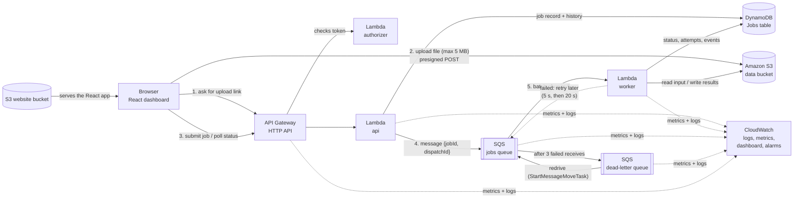
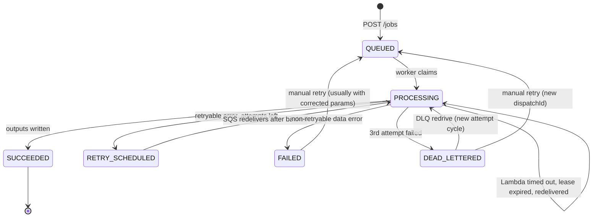

# QueuePilot architecture

QueuePilot accepts files from a browser, processes them **asynchronously** on AWS, and makes failures visible and recoverable. "Asynchronous" means the API answers immediately ("your job is queued") and the actual work happens a moment later in a separate worker.

## 1. The big picture

All of it is defined in one file, [`backend/template.yaml`](../backend/template.yaml) (AWS SAM, which becomes AWS CloudFormation when deployed).

## 2. What happens to one job

1. **Upload.** The browser calls `POST /uploads` and gets a *presigned POST*: a short-lived (5-minute) permission slip that lets the browser upload one file to one exact S3 key. S3 itself enforces the policy, rejecting anything over 5 MB or with the wrong content type. The file never passes through Lambda.
2. **Submit.** The browser calls `POST /jobs` with an `Idempotency-Key` header. The API:
   - validates the type, parameters and file extension, and checks the upload really exists (S3 `HeadObject`);
   - writes three items in **one DynamoDB transaction**: the job, its `SUBMITTED` event and the idempotency record;
   - sends a tiny SQS message `{ jobId, dispatchId }`;
   - answers `202 Accepted`.
3. **Claim.** SQS triggers the worker Lambda with up to 5 messages. For each message the worker reads the job and decides (see `backend/src/lib/claim.ts`):
   - a **stale** message (its `dispatchId` no longer matches the job) is discarded;
   - a **duplicate** of a finished job is discarded;
   - a duplicate that arrives **while another worker holds the lease** is deferred;
   - otherwise the worker *claims* the job with a **conditional update** (status and dispatchId must still match), so only one worker can win.
4. **Work.** The worker runs fault injection if requested, reads the file from S3, runs the processor (`csv.summary`, `text.analytics` or `data.validate`), writes the outputs to `outputs/<jobId>/`, and marks the job `SUCCEEDED`.
5. **Failure handling.**
   - **Non-retryable** (bad data or parameters, e.g. 30 % malformed rows): `FAILED` immediately. The message is deleted, because retrying the same input cannot help. The user fixes the file or parameters and retries.
   - **Retryable** (anything else, such as a timeout, an S3 hiccup or an injected fault): `RETRY_SCHEDULED`. The worker calls `ChangeMessageVisibility` so SQS redelivers after **5 s**, then **20 s** (exponential backoff), and reports the message as a *batch item failure*.
   - **Out of attempts** (3rd attempt failed): the job is marked `DEAD_LETTERED`. On the next receive, SQS's **redrive policy** (`maxReceiveCount: 3`) moves the message to the **dead-letter queue**, and the DLQ alarm fires.
6. **Recovery.**
   - **Per-job retry** (`POST /jobs/{id}/retry`, optionally with corrected parameters or fault injection turned off) gives the job a **new `dispatchId`** and queues a fresh message. Any old copy left in the DLQ is now stale and will be ignored.
   - **Bulk redrive** (`POST /dlq/redrive`) uses SQS's native `StartMessageMoveTask` to move every DLQ message back to the main queue. A redriven job starts a fresh cycle of 3 attempts.

## 3. Job states

| Status | Meaning | Where the SQS message is |
|---|---|---|
| `QUEUED` | Waiting for a worker | Main queue, visible |
| `PROCESSING` | A worker holds a 20-second lease | Main queue, in flight (invisible) |
| `RETRY_SCHEDULED` | Failed, will retry after backoff | Main queue, invisible until the backoff ends |
| `SUCCEEDED` | Done, results in S3 | Deleted |
| `FAILED` | Data/parameter problem, needs a fix | Deleted |
| `DEAD_LETTERED` | All attempts failed | Dead-letter queue |

## 4. Data model (DynamoDB single table)

| PK | SK | Item |
|---|---|---|
| `JOB#<jobId>` | `META` | The job record (status, attempts, params, outputs, last error, lease, …) |
| `JOB#<jobId>` | `EVT#<time>#<random>` | One timeline event (shown as the "Attempt history") |
| `IDEM#<key>` | `META` | Idempotency key → jobId and a SHA-256 of the request (expires after 24 h) |
| `BACKUP#<id>` | `META` | Backup metadata (the snapshot itself is a JSON file in S3) |

- **GSI1** (`GSI1PK="JOBS"`, `GSI1SK=createdAt`) powers the newest-first job list. `GSI1PK="BACKUPS"` powers the backup list.
- **GSI2** (`GSI2PK="STATUS#<status>"`, `GSI2SK=updatedAt`) powers the status filter and the counts.
- **TTL** (`expiresAt`): DynamoDB deletes job items after 7 days and backup records after 30 days, at no cost.

*Trade-off:* `GSI1PK="JOBS"` puts every job in one index partition. That is perfectly fine for a demo (thousands of jobs), but a production system would shard this key (e.g. `JOBS#<day>`).

## 5. HTTP API

All routes except `/health` require `Authorization: Bearer <demo token>`.

| Method | Route | Purpose |
|---|---|---|
| GET | `/health` | Liveness check (no token) |
| POST | `/uploads` | Presigned S3 POST for one file (≤ 5 MB) |
| POST | `/jobs` | Submit a job (`Idempotency-Key` header supported) |
| GET | `/jobs?status=&limit=&cursor=` | Paginated job list, newest first |
| GET | `/jobs/{jobId}` | Job + timeline + 15-minute download links |
| DELETE | `/jobs/{jobId}` | Delete the job record (finished jobs only; used to demo restore) |
| POST | `/jobs/{jobId}/retry` | Retry with optional `{ params, failMode }` corrections |
| GET | `/system/metrics` | Live queue depths (SQS) + counts by status (DynamoDB) |
| GET | `/dlq/messages` | Preview up to 10 DLQ messages, with "stale" detection |
| POST | `/dlq/redrive` | Start a native SQS DLQ redrive |
| GET | `/dlq/redrive` | Redrive task progress |
| POST | `/backups` | Snapshot selected job records to S3 |
| GET | `/backups` | List backups |
| POST | `/backups/{backupId}/restore` | Restore (`missing-only` or `overwrite`) after a SHA-256 integrity check |

Errors always look like `{ "error": { "code", "message", "requestId" } }`. Internal errors never leak details; the `requestId` finds them in CloudWatch Logs.

## 6. Key design decisions

| Decision | Why | Trade-off |
|---|---|---|
| HTTP API instead of REST API | About 70 % cheaper, built-in CORS and throttling | No API keys/usage plans, so a Lambda authorizer is used |
| One `api` Lambda with a router | Fewer cold starts, faster to build | Its IAM role covers all routes, though still only QueuePilot's own resources |
| SQS + DLQ instead of Step Functions | Simple, cheap, and the classic pattern to teach | Retry logic lives in code instead of a visual workflow |
| Backoff via `ChangeMessageVisibility` | Retries after 5 s/20 s instead of the 90 s visibility timeout | Slightly more code |
| Worker marks `DEAD_LETTERED` (no Lambda consuming the DLQ) | Messages stay visible in the DLQ, so native redrive works | Relies on attempt counters; the DLQ depth metric remains the source of truth |
| `dispatchId` fencing + leases + conditional writes | Safe under SQS at-least-once delivery, retries and redrive | More states to explain (see section 3) |
| SQS `MaximumConcurrency: 3` | Caps cost and blast radius without touching account concurrency quotas | Throughput is capped (fine for a demo) |
| Explicit event source mapping | Worker SQS permissions scoped to one queue | SAM's shortcut would attach a managed policy on all queues |
| Fonts bundled, no CDN | The dashboard makes no third-party requests | Slightly larger build |
| Polling instead of WebSockets | Simple, cheap, robust | Updates appear every 2–5 s instead of instantly |

## 7. Known limitations (honest list)

- **Duplicate deferral.** If a duplicate SQS delivery arrives while another invocation is processing, it is deferred until that invocation's lease ends. Each deferral consumes one receive, so in a pathological case a job could be dead-lettered early. It is then recoverable with Retry or redrive.
- **Timeouts on the last attempt.** If a Lambda *times out* on the final attempt, it cannot record `DEAD_LETTERED`. The job stays `PROCESSING`, and the UI shows "lease expired". **Retry** is allowed for exactly this case.
- **Redrive receive counts.** Redrive is assumed to give moved messages a fresh SQS receive count. The worker's attempt counter resets on redrive either way. The e2e test `permanent fault reaches the real DLQ, then is recovered…` verifies this on the live stack.
- **DLQ preview is a sample.** SQS short polling returns a subset of servers' messages.
- **Backups contain records, not files.** Input and output files expire from S3 after 3 days.
- **Demo-token authentication.** This suits a demo, not real users (see [SECURITY.md](SECURITY.md)).
