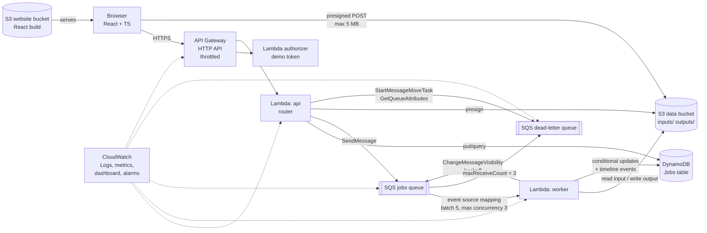

# QueuePilot — MVP Implementation Plan

> Status: **APPROVED (10 Oct 2026) and implemented locally.** Nothing has been deployed or created in AWS yet.
> Timebox: 1.5 days (~13 focused hours). AWS budget: $130 (target real spend: < $5).
>
> **Changes made during implementation (all documented in the docs folder):**
> - Added **backup and restore** of selected job records (S3 snapshots with SHA-256 integrity check) and `DELETE /jobs/{id}` to demonstrate it.
> - Added a separate **`FAILED`** status for non-retryable data/parameter errors: they skip retries and never enter the DLQ. `DEAD_LETTERED` is reserved for retryable errors that exhausted all attempts.
> - The `slow` fault times out on attempt 1 only and then succeeds, which shows Lambda timeout recovery. Its retry waits for the 90 s visibility timeout.
> - Worker SQS trigger declared as an explicit `AWS::Lambda::EventSourceMapping`, so its SQS permissions are scoped to one queue.
> - The website bucket always exists; only its *public* exposure depends on `EnableWebsite`. This works around a SAM CORS translation issue.
> - Lambda code is bundled by our own esbuild script and deployed with `sam deploy`, with no `sam build` and no Docker.
> - Router: `HashRouter` (robust on S3 website hosting). Fonts are bundled (no CDN).
> - The original section 11 decisions were accepted with their defaults: us-east-1, S3 website, demo-token authorizer, dashboard-only alarms (optional SNS email), and you run every deployment command.

---

## 1. Workspace inspection (as found)

- `D:\QueuePilot` is **empty**: no code, no git repo, no config. This is a greenfield build.
- The machine's toolchain (Node, AWS CLI, SAM CLI, Git) has **not** been verified yet. Stage 0 covers that.
- Implication: nothing has to be migrated, and every file comes from this plan.

---

## 2. What the MVP does (scope)

QueuePilot accepts **real files** from a browser, processes them **asynchronously** on AWS, and makes failure handling visible and recoverable.

**Real job types** (actual computation on actual uploaded data, results written to S3):

| Job type | Input | Real work performed | Output (S3) |
|---|---|---|---|
| `csv.summary` | CSV file | Parse + validate rows, compute per-column count/null/min/max/mean, top categories, flag bad rows | `result.json` + `cleaned.csv` |
| `text.analytics` | `.txt` / `.md` | Word/sentence counts, reading time, top-N terms (stop-word filtered), longest sentences | `result.json` |
| `data.validate` | JSON or CSV + a simple rule set | Checks required fields, types, and ranges, then reports violations | `report.json` |

**Failure modes** come in two kinds, and the UI and docs label them honestly:
- **Natural failures**, such as a malformed CSV, a missing input object, or an oversized file. These are real errors from real code paths.
- **Fault injection** (a demo control called `failMode`), which runs the real worker on real AWS but fails on purpose:
  - `transient`: throws on attempts 1–2 and succeeds on attempt 3, which demonstrates retry with backoff.
  - `permanent`: always throws, so the job exhausts its retries and lands in the **real SQS DLQ**.
  - `slow`: sleeps past the worker's timeout, which demonstrates a Lambda timeout followed by a retry.

**Recovery features:**
- Per-job retry, with optional parameter edits ("fix and retry").
- Bulk DLQ redrive, using SQS's native `StartMessageMoveTask` API.
- Idempotent job submission (`Idempotency-Key` header).
- Stale and duplicate message protection (`dispatchId` fencing).

**Out of scope for the MVP:** user accounts and sign-up, multi-tenant isolation, scheduling or cron jobs, job cancellation mid-flight, and a custom domain.

---

## 3. Architecture



### 3.1 Request lifecycle

1. **Upload.** `POST /uploads` returns an S3 **presigned POST**. The policy limits the upload to the `inputs/{uploadId}/` prefix, caps the size at 5 MB with `content-length-range`, and sets a 5-minute expiry. The browser uploads directly to S3, so the file never passes through Lambda.
2. **Submit.** `POST /jobs` with `{type, inputKey, params, failMode}` and an `Idempotency-Key` header. The API Lambda:
   - writes the job item with a conditional put (`attribute_not_exists`). This makes resubmission with the same key return the original job instead of creating a duplicate.
   - generates a `dispatchId` and sends an SQS message `{jobId, dispatchId}`.
   - returns `202 Accepted` with the `jobId`.
3. **Process.** SQS triggers the **worker** Lambda (batch size 5, `ReportBatchItemFailures` on, `MaximumConcurrency` 3). For each message, the worker:
   - checks the job in DynamoDB and **discards stale messages** whose `dispatchId` does not match the job's current one. This handles retries and redrives safely.
   - moves the status to `PROCESSING` with a conditional update and increments `attempts`.
   - reads the input from S3, runs the processor, and writes the output to `outputs/{jobId}/`.
   - on success, sets the status to `SUCCEEDED` with the output key, duration, and a timeline event.
4. **Fail and retry.** On an exception, the worker:
   - records the error and sets the status to `RETRY_SCHEDULED`.
   - calls `ChangeMessageVisibility` with exponential backoff (5 s, then 20 s).
   - reports the item as failed, so SQS redelivers it after the backoff.
5. **Dead-letter.** On the final attempt (`ApproximateReceiveCount` ≥ 3), the worker marks the job `DEAD_LETTERED` before failing the message. SQS's redrive policy then moves the message to the **DLQ**, and a CloudWatch alarm fires on DLQ depth > 0.
6. **Recover.** There are two ways back:
   - **Per-job retry** (`POST /jobs/{id}/retry`, optionally with corrected params) issues a new `dispatchId` and enqueues a fresh message. The old DLQ copy becomes stale and is safely ignored if it is ever redriven.
   - **Bulk redrive** (`POST /dlq/redrive`) calls SQS `StartMessageMoveTask` to move every DLQ message back to the main queue. The UI polls its progress with `ListMessageMoveTasks`.

### 3.2 Job state machine

```
QUEUED → PROCESSING → SUCCEEDED
              │
              ├→ RETRY_SCHEDULED → PROCESSING …  (up to 3 attempts)
              └→ DEAD_LETTERED → (retry / redrive) → QUEUED
```

### 3.3 DynamoDB design (single table: `QueuePilot-Jobs`, on-demand)

| Item | PK | SK | Key attributes |
|---|---|---|---|
| Job | `JOB#{jobId}` | `META` | type, status, attempts, dispatchId, inputKey, outputKey, params, failMode, lastError, createdAt, updatedAt, durationMs, retryCount |
| Timeline event | `JOB#{jobId}` | `EVT#{iso-ts}#{seq}` | event (`SUBMITTED`, `STARTED`, `FAILED`, `RETRY_SCHEDULED`, `SUCCEEDED`, `DEAD_LETTERED`, `REQUEUED`), message, attempt |
| Idempotency | `IDEM#{key}` | `META` | jobId, TTL 24 h |

- **GSI1, recent jobs:** `GSI1PK = "JOBS"`, `GSI1SK = createdAt`. Fine at demo scale. Production would shard this key.
- **GSI2, by status:** `GSI2PK = status`, `GSI2SK = updatedAt`. This powers the "Dead-lettered jobs" view.
- **TTL attribute:** `expiresAt` (7 days) keeps the table small.

### 3.4 API (HTTP API, all JSON)

| Method | Route | Purpose |
|---|---|---|
| POST | `/uploads` | Presigned POST for an input file |
| POST | `/jobs` | Submit a job (idempotent) |
| GET | `/jobs?status=&cursor=` | List jobs (paginated) |
| GET | `/jobs/{id}` | Job + timeline + presigned GET for output |
| POST | `/jobs/{id}/retry` | Re-enqueue a failed/dead-lettered job, optionally with new params |
| GET | `/system/metrics` | Live queue depths (main, in-flight, DLQ) + status counts |
| POST | `/dlq/redrive` | Start native SQS DLQ redrive |
| GET | `/dlq/redrive` | Redrive task status |
| GET | `/health` | Liveness (no auth) |

### 3.5 Design decisions and trade-offs

- **HTTP API over REST API.** It is about 70% cheaper and has native CORS and simple stage throttling. The cost is no usage plans or API keys, which the Lambda authorizer covers instead.
- **One `api` router Lambda plus one `worker` Lambda,** rather than one Lambda per route. This means fewer cold starts and faster delivery within 1.5 days. The cost is that the api role holds the union of route permissions, though everything stays scoped to QueuePilot's own resources.
- **The worker marks `DEAD_LETTERED`** instead of a separate Lambda consuming the DLQ. Messages stay visible in the DLQ, which is better for the demo and for native redrive. The trade-off is that the status relies on `ApproximateReceiveCount`. This is documented, and the DLQ depth metric remains the source of truth.
- **Backoff via `ChangeMessageVisibility`.** Without it, retries wait out the full visibility timeout, which would be about 1 minute per attempt. With it, a job reaches the DLQ in about 30 seconds, which works for a live demo.
- **SQS `MaximumConcurrency` instead of Lambda reserved concurrency.** New AWS accounts often have a concurrency quota of 10, and reserving concurrency there can **fail the deploy**. `MaximumConcurrency` caps runaway scaling without touching account quotas.
- **Runtime:** `nodejs22.x` on **arm64** (about 20% cheaper than x86), bundled with esbuild through SAM. No Docker is required.

---

## 4. Folder structure

```
QueuePilot/
├─ README.md                    # quick start, prerequisites, deploy/teardown
├─ package.json                 # npm workspaces: shared, backend, frontend
├─ .gitignore  .editorconfig  .nvmrc
├─ docs/
│  ├─ PLAN.md                   # this file
│  ├─ ARCHITECTURE.md           # diagrams, data model, state machine
│  ├─ AWS_SERVICES.md           # every service: why, how configured, IAM, cost, where to see it in console
│  ├─ COST_CONTROL.md
│  ├─ TESTING.md
│  ├─ DEPLOYMENT.md             # credential setup (no keys in repo), deploy, teardown
│  ├─ DEMO_SCRIPT.md            # minute-by-minute live demo + fallback plan
│  └─ RUNBOOK.md                # alarms → what they mean → what to do
├─ shared/                      # types + zod schemas used by backend AND frontend
│  └─ src/{job.ts, api.ts, index.ts}
├─ backend/
│  ├─ template.yaml             # AWS SAM / CloudFormation — single source of infra truth
│  ├─ samconfig.toml            # stack name, region, tags (NO credentials)
│  ├─ src/
│  │  ├─ handlers/{api.ts, worker.ts, authorizer.ts}
│  │  ├─ routes/{uploads.ts, jobs.ts, retry.ts, metrics.ts, dlq.ts}
│  │  ├─ processors/{csvSummary.ts, textAnalytics.ts, dataValidate.ts, faultInjection.ts, index.ts}
│  │  └─ lib/{config.ts, ddb.ts, jobsRepo.ts, sqs.ts, s3.ts, http.ts, logger.ts, errors.ts, backoff.ts}
│  └─ tests/
│     ├─ unit/                  # processors, repo, router, worker state transitions
│     └─ e2e/                   # runs against the DEPLOYED stack
├─ frontend/
│  ├─ index.html  vite.config.ts  .env.example
│  └─ src/
│     ├─ api/client.ts          # typed fetch client
│     ├─ hooks/{usePolling.ts, useJobs.ts}
│     ├─ pages/{Dashboard.tsx, SubmitJob.tsx, JobDetail.tsx, Recovery.tsx}
│     ├─ components/{StatusBadge, Timeline, QueueGauge, JobTable, FileDrop, …}
│     └─ App.tsx  main.tsx  styles.css
├─ infra/
│  └─ budget.yaml               # optional AWS Budgets stack (alerts by email)
├─ scripts/
│  ├─ preflight.ps1             # checks node/aws/sam versions + caller identity (prints ARN only)
│  ├─ deploy-backend.ps1        # sam build + sam deploy
│  ├─ deploy-frontend.ps1       # writes .env from stack outputs, builds, syncs to S3
│  ├─ burst.ts                  # submits N real jobs for the scaling demo
│  └─ teardown.ps1              # empties buckets, sam delete, verifies nothing left
└─ sample-data/  sales.csv  malformed.csv  article.txt  orders.json
```

**Shell note:** Windows is the deploy machine, so scripts are PowerShell. I'll write and test code in a Linux sandbox, which means native dependencies (esbuild, rollup) installed there won't run on Windows. **`node_modules` is disposable:** you run `npm ci` once on Windows before deploying, and the README spells this out.

---

## 5. Frontend (React + TypeScript + Vite)

- **Dashboard:** live queue gauges (visible, in-flight, DLQ), counts by status, and a recent-jobs table. Polls every 3 seconds and pauses when the tab is hidden, which saves requests.
- **Submit job:** a file drop zone, job type, params, and a clearly labeled "Fault injection (demo)" selector, plus a "Submit 20 copies" burst button.
- **Job detail:** the status badge, a timeline of every attempt with errors and backoff, a link to download the output (a presigned S3 GET), and raw JSON views.
- **Recovery center:** dead-lettered jobs with Retry or Edit & retry, a "Redrive all from DLQ" button with live task progress, and the DLQ depth.
- **Honesty rule:** the UI shows **no hardcoded or sample data**. Every number comes from the API, and an empty state reads "No jobs yet".

---

## 6. Cost-control plan ($130 budget)

### 6.1 Expected spend
Every component is serverless and pay-per-use, with **no idle cost**: no VPC, NAT Gateway, EC2, RDS, provisioned capacity, or KMS customer-managed keys (which cost $1 per month each).

| Service | Demo usage estimate (~5,000 jobs total) | Approx. cost |
|---|---|---|
| Lambda (arm64, 256–512 MB) | ~20k invocations | ≈ $0 (free tier) to < $0.10 |
| API Gateway HTTP API | ~50k requests (polling included) | ≈ $0.05 |
| SQS (+ DLQ) | ~30k requests | ≈ $0 (1M free) |
| DynamoDB on-demand | ~100k writes / reads | < $0.15 |
| S3 | < 100 MB, short-lived | < $0.05 |
| CloudWatch Logs / metrics / 1 dashboard / ~5 alarms | Logs ≪ 1 GB | < $1 |
| **Total for build + demo period** | | **≈ $1–5** |

Free-tier eligibility depends on your account's age and plan type. **I'll confirm current prices on the AWS pricing pages before the first deploy** rather than relying on these estimates.

### 6.2 Guardrails (built into the template)
1. **AWS Budget first.** Before anything else is deployed, set a $130 monthly budget with email alerts at **$5, $20, $50, and $100**, both actual and forecasted. `infra/budget.yaml` provides this, or you can click it together in the console in about 2 minutes.
2. **API Gateway throttling:** 10 requests per second steady and burst 20. A leaked URL can't run up a bill.
3. **Demo-token authorizer** on every route except `/health`, with results cached for 5 minutes, so the authorizer is invoked rarely.
4. **Worker scaling cap:** SQS `MaximumConcurrency: 3`. Lambda timeouts: worker 15 s, api 10 s.
5. **Upload cap:** 5 MB, enforced by the presigned POST policy (S3 rejects anything larger).
6. **Retention limits:**
   - CloudWatch log groups are declared explicitly with **7-day retention**, because the default is to keep logs forever.
   - S3 lifecycle rules expire `inputs/` and `outputs/` after **3 days** and abort incomplete uploads after 1 day.
   - SQS retention is 1 day for the main queue and 4 days for the DLQ.
   - DynamoDB TTL is 7 days.
7. **Tags** `Project=QueuePilot` and `Env=dev` on every resource, for Cost Explorer filtering.
8. **One-command teardown** (`scripts/teardown.ps1`): empties both buckets, runs `sam delete`, then lists any remaining `Project=QueuePilot` resources to prove nothing is left.
9. **Burst tool hard limit:** `burst.ts` refuses more than 200 jobs per run.

---

## 7. Security and credentials

- **I will never ask for, read, or store AWS credentials.** You deploy from your own terminal with your own identity. That should be IAM Identity Center (`aws configure sso`) or an IAM user with MFA, **never root**. `preflight.ps1` prints only the caller ARN, so you can confirm the right account.
- **No secrets in the repo.** `samconfig.toml` holds the stack name and region only. The demo token is a CloudFormation `NoEcho` parameter that you type at deploy time, and `.env` files are git-ignored.
- **Least-privilege IAM** through SAM policy templates scoped to this stack's own table, queues, and bucket ARNs:
  - **worker:** S3 read on `inputs/*` and write on `outputs/*`, DynamoDB CRUD on its table, SQS receive, delete, and change visibility on the main queue.
  - **api:** DynamoDB CRUD, SQS send on the main queue, DLQ attributes and move-task permissions, and S3 presign on its prefixes.
- **Data bucket:** Block Public Access on, SSE-S3 encryption, TLS-only bucket policy, and CORS restricted to the frontend origin.
- **API CORS:** limited to the frontend origin and `localhost:5173`.

---

## 8. Testing strategy

| Layer | Tool | What it proves | When |
|---|---|---|---|
| Static | `tsc --noEmit`, ESLint | Types across shared, backend, and frontend | Every stage |
| Infra lint | `sam validate --lint` (cfn-lint) | Template is valid and follows best-practice rules | Before every deploy |
| Unit | Vitest | Processors on real sample files (CSV stats are exact, malformed rows are flagged), backoff math, state transitions, idempotency, stale-`dispatchId` discard, router validation | Stage 2 onward |
| Unit (AWS edges) | Vitest + `aws-sdk-client-mock` | Correct AWS calls and parameters (conditional expressions, batch item failures) | Stage 2 |
| Frontend | Vitest + React Testing Library | Status badge mapping, timeline rendering, polling pause, error states | Stage 4 |
| **End-to-end (real AWS)** | Vitest e2e suite hitting the deployed API | **Live** upload → job → S3 output for each type; transient → 3 attempts → success; permanent → `DEAD_LETTERED` **and** DLQ depth ≥ 1; per-job retry; bulk redrive; idempotency replay; 401 without token; 413 / 400 on bad input | After each deploy |
| Smoke / scale | `burst.ts` (100 jobs) | Queue drains, concurrency cap respected, no lost jobs (submitted = succeeded + dead-lettered) | Stage 5, demo rehearsal |
| Manual | Demo script dry run | Full demo end to end, timed | Stage 6 |

**On mocks:** `aws-sdk-client-mock` is used **only in unit tests**, which check that the code calls AWS correctly. The application itself never uses mock data. The e2e suite is what proves the system works on real AWS, and it **is the acceptance gate** for each stage.

---

## 9. Staged delivery schedule (~13 h + buffer)

| Stage | Hours | Deliverables | Exit gate |
|---|---|---|---|
| **0 – Prerequisites** (you, ~20 min) | 0.5 | Node 22 LTS, AWS CLI v2, SAM CLI, Git installed. SSO or MFA identity configured. Budget alerts set | `preflight.ps1` passes |
| **1 – Scaffold + infra** | 2 | Monorepo, shared schemas, full `template.yaml`, sample data | `tsc` ✓, `sam validate --lint` ✓ |
| **2 – Backend** | 3 | api router, worker, 3 processors, fault injection, idempotency, backoff, recovery routes | Unit tests ✓, coverage ≥ 80% on lib and processors |
| **3 – First live deploy** (you run 1 command) | 1 | Stack in AWS | **e2e suite ✓ against real AWS**. I pause here and report |
| **4 – Frontend** | 3 | All 4 pages wired to the live API | Component tests ✓, manual walkthrough against the real stack |
| **5 – Observability** | 1.5 | CloudWatch dashboard (queue depth, DLQ, worker errors and duration, API 4xx/5xx/latency), 4 alarms, structured JSON logs with `jobId` correlation | Alarm demonstrably goes `ALARM` on a DLQ message |
| **6 – Hosting, docs, demo prep** | 1.5 | Frontend on S3, all `docs/*`, demo script, teardown verified | Full demo rehearsal ✓ |
| Buffer | 2 | — | — |

Each stage ends with a short report covering what was built, test results, and anything that changed from this plan. You run every command that touches AWS, and I give you the exact command for each.

---

## 10. Live demo outline (≈ 8 minutes; full script in `docs/DEMO_SCRIPT.md`)

1. Architecture slide → dashboard with empty state (proves no seeded data).
2. Upload `sales.csv` → job goes `QUEUED → PROCESSING → SUCCEEDED` → download the real result from S3.
3. Show the same job in the **DynamoDB console**, the output object in the **S3 console**, and the worker log line in **CloudWatch Logs** (filter by `jobId`).
4. `transient` job → timeline shows 2 failures, backoff, then success.
5. `permanent` job and a real malformed CSV → both `DEAD_LETTERED` → **SQS console** shows DLQ depth 2 → **CloudWatch alarm** goes red.
6. Recovery: fix params and retry one, then bulk-redrive the other and watch the move task.
7. Burst 100 jobs → queue depth graph rises and drains while concurrency stays capped at 3.
8. Cost slide: real spend in Billing/Cost Explorer, guardrails, teardown command.

**Fallback:** if conference Wi-Fi or AWS has a bad moment, a pre-recorded screen capture from the rehearsal (taken in Stage 6) is ready.

---

## 11. Decisions I need from you (defaults apply if you approve as-is)

1. **Region:** default **`us-east-1`**. Any region works, but pick one and keep it.
2. **Frontend hosting:** default is an **S3 static website**, which uses only your listed services. Its limits are that it serves HTTP only and needs a public-read bucket, and some accounts block that with account-level Block Public Access. Alternatives:
   - add **CloudFront**, which gives HTTPS and a private bucket and costs pennies.
   - run the UI **locally** against the live API, which is still fully real.
3. **API protection:** default is a **demo-token Lambda authorizer**, recommended because the API URL becomes public. The alternative is throttling only, with no token.
4. **Alarm notifications:** default is alarms on the dashboard only. You can optionally add **SNS email** alerts (free at this volume), which adds one service.
5. **Who deploys:** default is that **you run** `deploy-backend.ps1` in your terminal, and I prepare and verify everything up to that point. That keeps credentials entirely on your side.
